# Lab 01: Host a Website on AWS EC2

**Status:** Completed  
**Services/tools:** Amazon EC2, Linux, SSH, Apache HTTP Server (`httpd`), HTML, `curl`

## Objective

Launch an EC2 Linux instance, connect using SSH, install Apache, create a basic HTML page, and verify that the web server responds successfully.

## Architecture

```text
Local computer
    | SSH
    v
Amazon EC2 Linux instance
    |
    v
Apache HTTP Server (httpd)
    |
    v
/var/www/html/index.html
    |
    v
Browser: "Hello from AWS EC2!"
```

## Steps Performed

1. Launched an EC2 instance in the AWS Management Console.
2. Connected to the Linux instance using SSH from Windows Terminal.
3. Checked the Linux identity, operating system, storage, memory, and network interface.
4. Created a working directory and a notes file.
5. Installed the Apache HTTP Server package.
6. Created an HTML page at `/var/www/html/index.html`.
7. Checked that the Apache service was active.
8. Used `curl` to verify the local HTTP response.
9. Opened the hosted page in a browser.

## Commands Used

Check current user and host:

```bash
whoami
hostname
```

Inspect OS, storage, and memory:

```bash
cat /etc/os-release
df -h
free -h
```

Inspect network interfaces:

```bash
ip addr
```

Install Apache on RHEL/Amazon Linux systems where `dnf` is available:

```bash
sudo dnf install httpd -y
sudo systemctl enable --now httpd
```

Check the package and service:

```bash
rpm -q httpd
sudo systemctl status httpd
```

Create a basic web page:

```bash
echo '<!DOCTYPE html><html><head><title>AWS EC2 Lab</title></head><body><h1>Hello from AWS EC2!</h1><p>My first cloud-hosted website.</p></body></html>' | sudo tee /var/www/html/index.html
```

Verify the HTTP response:

```bash
curl -I http://localhost
```

Expected result includes:

```text
HTTP/1.1 200 OK
```

## Screenshots

### EC2 instance in AWS Console
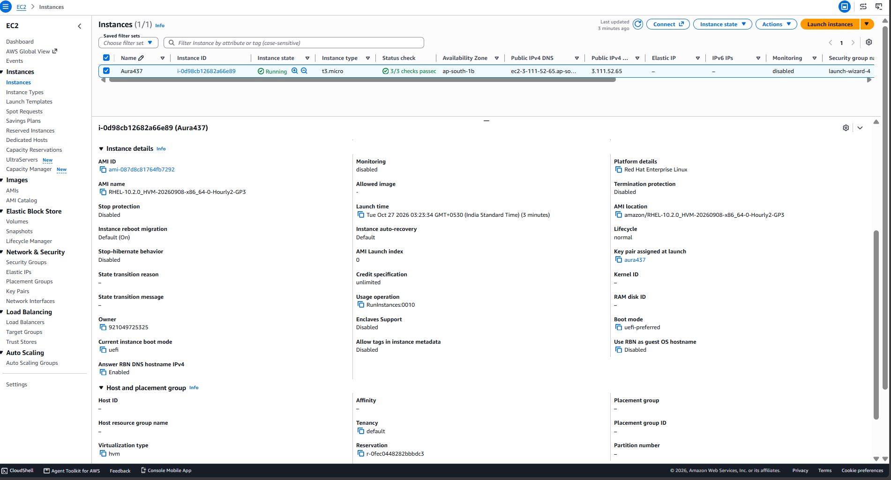

### EC2 instance details
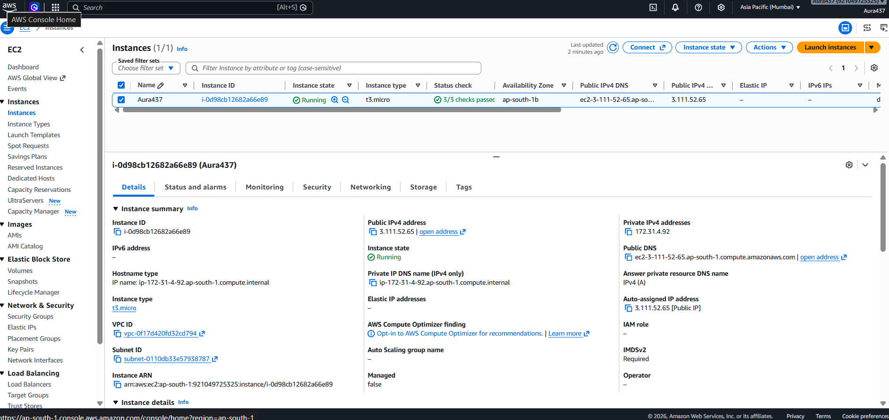

### EC2 connection page
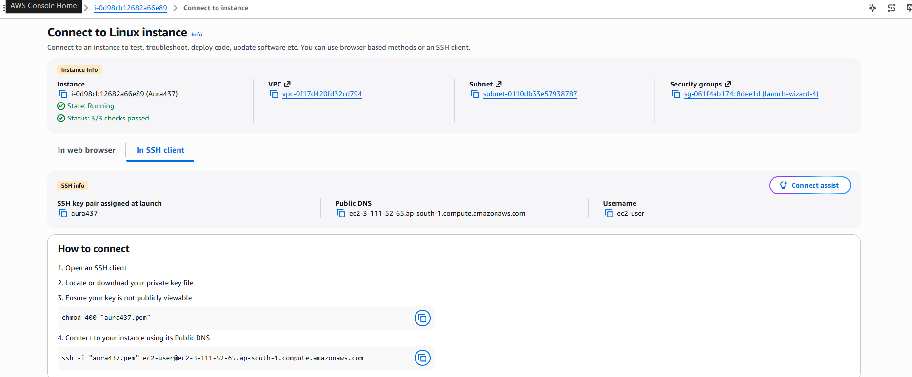

### Successful SSH session
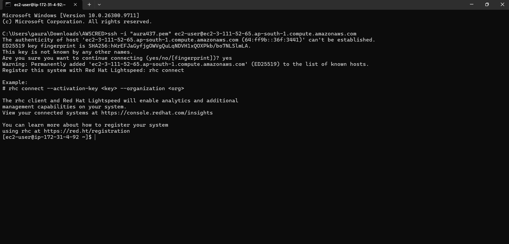

### Linux system information
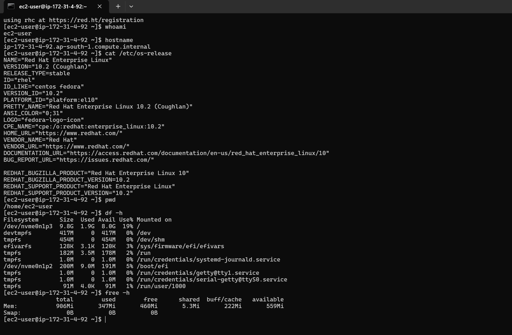

### Network interface information
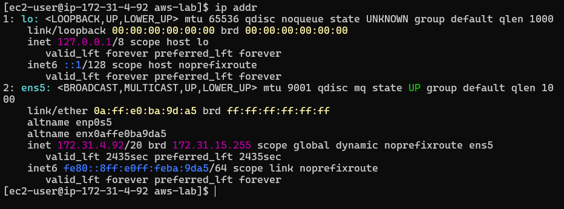

### Working directory and notes file
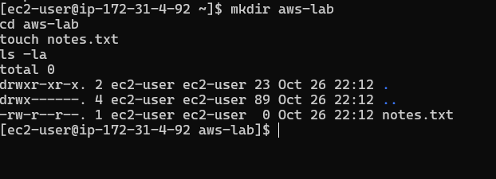

### Apache service status
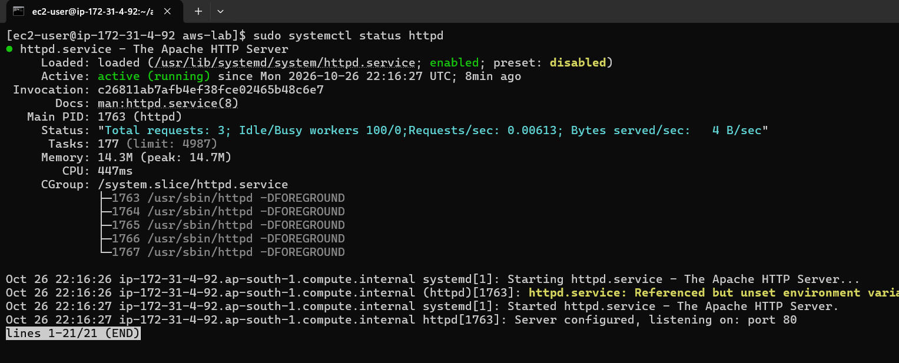

### Apache package installed
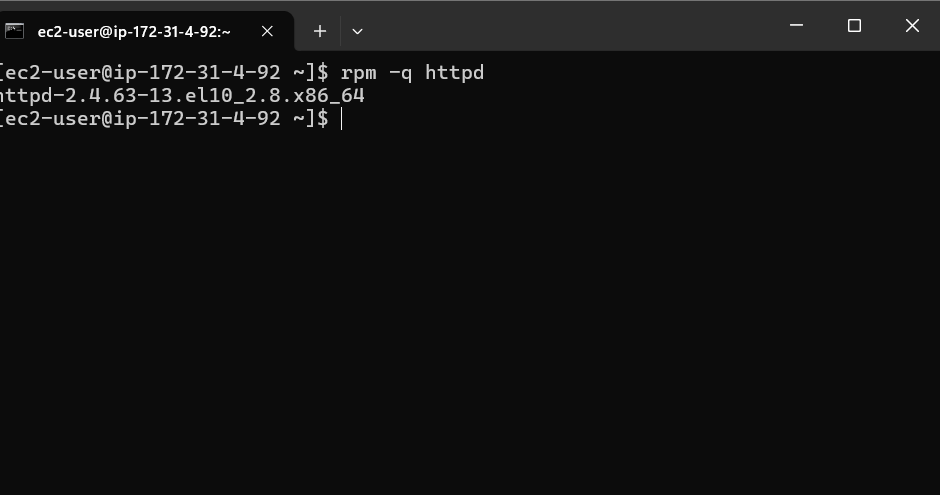

### HTML file created on the server
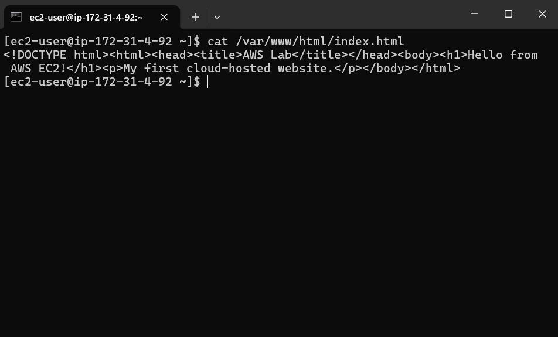

### HTTP response verification
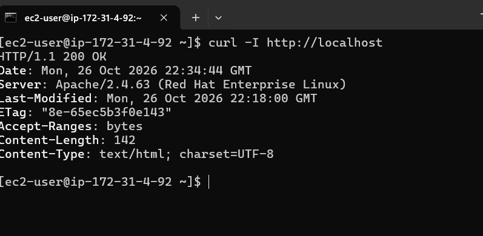

### Website opened in a browser
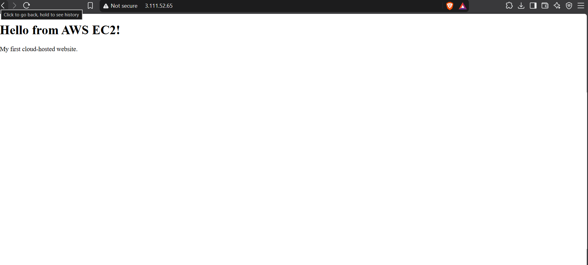

### Security Group and inbound rules
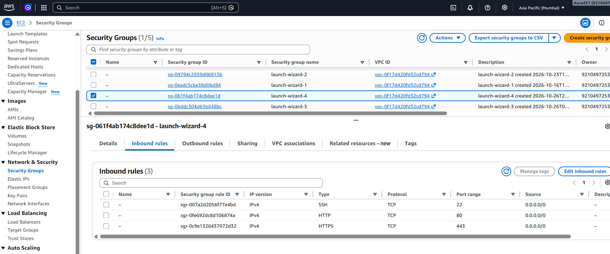

### EC2 instance list / details
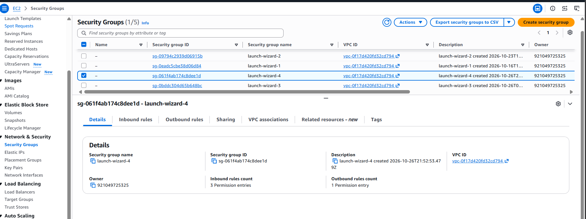

### Additional Linux command output
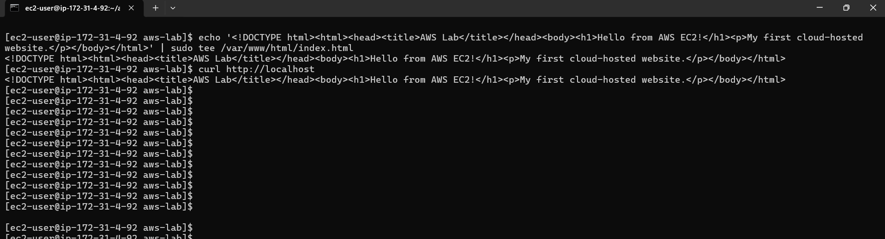

### Additional Linux command output


## Security Notes

- Keep SSH (TCP port 22) restricted to your own public IP whenever possible.
- Allow HTTP (TCP port 80) from the internet only if the website needs to be public.
- Do not upload private SSH keys, passwords, access keys, or session tokens.
- Review screenshots for account identifiers or public IP addresses before publishing.

## Cleanup

When you no longer need the lab, stop or terminate the EC2 instance from the AWS Console. Termination deletes the instance's local instance-store data; check whether any EBS volumes or Elastic IP addresses remain and whether they incur charges.

## Result

Successfully hosted a basic HTML webpage on an EC2 Linux instance using Apache and verified the server's HTTP response.
